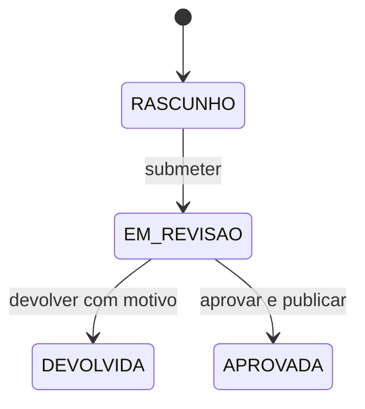

# Aprovação e publicação de planos

Este bloco implementa a fase 5 do backend. A aprovação cria um plano com uma cópia
fixa das células, consumível por API e CSV. Realizados e indicadores operacionais
estão implementados no [bloco de monitorização](monitorizacao.md). A interface gráfica
pertence aos próximos blocos.

## Ensaio manual

Na raiz do repositório, com backend e MySQL iniciados:

```bash
python3 scripts/testar_aprovacao.py
```

1. Enter na URL/email ADMIN usa `http://localhost:8080` e `admin@admin.com`.
   Introduzir a password ADMIN existente. Enter na execução seleciona a previsão
   operacional concluída mais recente com linhas.
2. Na primeira utilização, Enter em criar APROVADOR escolhe sim. O email proposto
   é `aprovador@exemplo.local`. Escolher uma password com pelo menos 12 caracteres
   e até 72 bytes UTF-8, e repeti-la. O script usa a API de gestão de utilizadores
   para convidar outra conta com o papel APROVADOR. O cliente de ensaio simula
   a ativação dessa conta com a password escolhida no terminal.
3. Nas utilizações seguintes, escolher `n` e indicar as credenciais dessa conta.
   Tentar criar novamente um email existente termina com instruções para repetir.

As passwords são pedidas no terminal e não ficam no código. Depois, o script cria
um cenário de ensaio, submete, verifica a recusa de ajuste após submissão, devolve
com motivo, cria outra revisão, acrescenta uma unidade à primeira célula, submete
e aprova com a segunda conta. Verifica a recusa de aprovação repetida e compara
todas as páginas da API com o CSV. Os `409` identificados como esperados fazem
parte das verificações. A mensagem de sucesso é:

```text
Ensaio concluido: submissao, devolucao, correcao, aprovacao e API/CSV verificados.
Logout ADMIN concluido.
Logout APROVADOR concluido.
```

O ficheiro fica em `tmp/exports/plano-<id>.csv`, ignorado pelo Git. O ensaio guarda
um cenário, duas revisões (DEVOLVIDA/APROVADA), um ajuste e um plano de teste;
preserva os cenários anteriores. Repetir guarda outro plano. Se houver falha de
rede, consultar os recursos antes de repetir: um pedido pode já ter sido guardado.
A publicação neste projeto é local, sem envio a terceiros.

## Estados, datas e versões



Cada transição exige `versaoEsperada` e incrementa a versão. A submissão guarda
`submetidoEm`; a decisão guarda `decididoEm`. Ambos são instantes UTC dos eventos
respetivos, visíveis em `GET /revisoes/{id}`. Uma revisão nova começa com datas de
submissão/decisão nulas e versão 0.

A submissão exige todas as células da previsão base e congela ajustes. A devolução
conserva células, motivo e eventos; a correção usa `POST /cenarios/{id}/revisoes`
com origem e versão, recebendo outro ID em RASCUNHO. APROVADA também permanece
congelada e pode originar uma revisão nova. Não há reabertura nem edição do plano.

## Perfis e independência

| Operação | Perfis |
|---|---|
| Submeter | ADMIN ou PLANEADOR |
| Aprovar ou devolver | APROVADOR independente |
| Consultar planos/API/CSV | ADMIN, PLANEADOR, COMERCIAL, APROVADOR ou CONSUMIDOR |

ADMIN não aprova automaticamente. Mesmo com vários papéis, uma conta não pode
decidir sobre uma revisão que criou ou em cujos ajustes participou, incluindo os
herdados através de várias cópias. Aprovação e devolução aplicam a mesma regra.

Usam-se os limites da auditoria dos cenários: ajustes posteriores à cópia na origem
não contam como intervenção na cópia. Um novo fator que recalculou os valores e
interrompeu a herança descarta os ajustes antigos para esta verificação. O criador
da revisão atual permanece sempre impedido. Autor e instantes vêm do servidor.

## Endpoints

Prefixo `/api/v1`; escritas exigem sessão e CSRF. A API de leitura também usa a
autenticação por sessão existente; não há tokens de máquina neste bloco.

| Método e caminho | Resposta |
|---|---|
| `POST /revisoes/{id}/submissao` | 200: revisão EM_REVISAO com nova versão |
| `POST /revisoes/{id}/devolucao` | 200: revisão DEVOLVIDA com nova versão |
| `POST /revisoes/{id}/aprovacao` | 201: IDs do plano/revisão e versão; Location do plano |
| `GET /planos` | Lista paginada de planos publicados |
| `GET /planos/{id}` | Cabeçalho e contagem de linhas |
| `GET /planos/{id}/linhas` | Células publicadas paginadas |
| `GET /planos/{id}/exportacao.csv` | Todas as células publicadas em CSV |

Listagens usam `page=0&size=50`, máximo 200. Linhas ordenadas por código, período
e ID de produto como desempate, tanto na API como no CSV. O cabeçalho e as linhas
têm endpoints separados para evitar JSON sem limite. IDs são strings, quantidades
são strings com quatro casas e meses usam `YYYY-MM`.

Submeter/aprovar: `{"versaoEsperada": 1}`. Devolver:

```json
{"versaoEsperada": 1, "motivo": "Rever a campanha antes da publicação."}
```

Motivo obrigatório, até 1000 caracteres, sem aceitar texto só com espaços.
Exemplo de aprovação bem-sucedida:

```json
{"planoId": "1", "revisaoId": "3", "versaoAtual": 3}
```

Cabeçalho ilustrativo `GET /planos/1`:

```json
{
  "id": "1", "revisaoId": "3", "cenarioId": "1", "execucaoId": "2",
  "versaoContrato": "v1", "aprovadoPor": "2",
  "aprovadoEm": "2026-11-10T20:00:00Z",
  "publicadoEm": "2026-11-10T20:00:00.001Z", "totalLinhas": 1
}
```

`GET /planos/1/linhas`, para esse plano de uma célula:

```json
{
  "items": [
    {"produtoId": "1", "produto": "SKU001", "periodo": "2026-11",
     "unidade": "un", "quantidadeBase": "100.0000", "quantidade": "120.0000"}
  ],
  "page": 0, "size": 50, "totalElements": 1, "totalPages": 1
}
```

O CSV inclui também a base:

```csv
plano_id;produto;periodo;unidade;quantidade_base;quantidade
1;SKU001;2026-11;un;100.0000;120.0000
```

CSV UTF-8, separador `;`, ponto decimal, quatro casas, CRLF e escape por Apache
Commons CSV, incluindo textos com separadores, aspas ou quebras de linha.
O download propõe `plano-<id>.csv` e lê as linhas com cursor MySQL dentro da
transação, sem carregar o plano inteiro em memória Java. Não depende da página
JSON nem recalcula valores. O ensaio com SKU001/horizonte 3 exporta três células.

Erros: 401 sem sessão; 403 sem perfil/CSRF ou por participação na revisão; 404
sem recurso; 409 para estado/versão ultrapassados ou células incompletas; 422 para
corpo inválido. Conflito de versão inclui `code: "VERSION_CONFLICT"` e
`currentVersion`. Atualizar a revisão antes de nova decisão explícita. Repetir a
aprovação não publica outro plano.

## Integridade e transações

Submissão, devolução, aprovação e ajustes bloqueiam a mesma linha da revisão antes
de verificar versão/estado. Um ajuste concorrente não atravessa o congelamento;
duas decisões concorrentes têm um único vencedor.

A aprovação guarda evento APROVACAO, estado/data/versão, plano e todas as linhas
numa só transação. Uma falha na cópia reverte tudo; não deixa plano parcial nem
revisão aprovada sem plano. A unicidade de `plano_publicado.revisao_id` reforça a
proteção contra duplicação.

O snapshot copia produto, mês, código, unidade, base e quantidade final aprovada.
As consultas não voltam a obter estes valores do catálogo/previsão/cenário.
Só são apresentados cabeçalhos ligados a revisão APROVADA e evento APROVACAO da
mesma revisão. Não há endpoints para editar/apagar planos.

As tabelas de publicação já pertencem à migração V1; não há migração nova nem
alteração de migrações aplicadas. Imutabilidade pela API não substitui a separação
futura de permissões SQL de execução/migração prevista na arquitetura.

Referências técnicas: [bloqueios MySQL](https://dev.mysql.com/doc/refman/8.4/en/innodb-locking-reads.html)
e [Apache Commons CSV](https://commons.apache.org/proper/commons-csv/apidocs/org/apache/commons/csv/CSVPrinter.html).

## Interface a construir

Submeter aparece para ADMIN/PLANEADOR em RASCUNHO. Após submissão, a grelha passa a
consulta e apresenta eventos/data/autor. Aprovar/Devolver pertencem ao APROVADOR
independente; devolver exige formulário com motivo. A revisão devolvida apresenta
Criar nova revisão. O servidor valida as regras mesmo que a interface oculte botões.
Após aprovação, mostrar ID do plano, aprovador/data e consulta/download. CONSUMIDOR
acede aos planos publicados.

## Validação desta entrega

Em 2026-11-10, `./mvnw -B verify` terminou com BUILD SUCCESS: 81 testes, zero falhas,
zero erros e zero ignorados. Inclui 13 testes novos de workflow com HTTP real e
MySQL Testcontainers: congelamento, devolução/correção, perfis/CSRF, independência
com ajustes locais/herdados e limites de herança, decisões concorrentes, corrida
ajuste/submissão, cópia incompleta e rollback após falha deliberada de gravação.
O teste do CSV comparou 213 linhas com todas as páginas da API, incluindo acentos,
aspas, separadores e quebras de linha, e confirmou que alterações nas fontes não
mudam o snapshot. O ensaio interativo com as credenciais locais fica para o utilizador.

O script passou a verificação sintática Python. Docker reconstruído: backend/MySQL
saudáveis; saúde e identificação 200; planos/CSV sem sessão 401. O SHA-256 do dump
de dados de todas as tabelas permaneceu igual antes/depois do arranque, confirmando
preservação dos dados existentes. Não foram criadas contas ou publicações na base
local durante estes testes automáticos.

## Proteção da exportação CSV

Códigos e unidades que possam ser interpretados como fórmulas recebem um
apóstrofo na exportação. A proteção abrange também snapshots antigos e preserva
os valores guardados. Os detalhes e limites estão na [revisão de segurança](seguranca.md).
