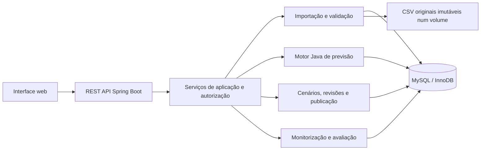
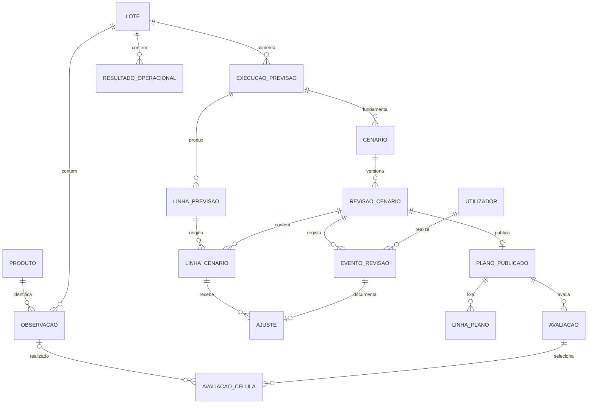
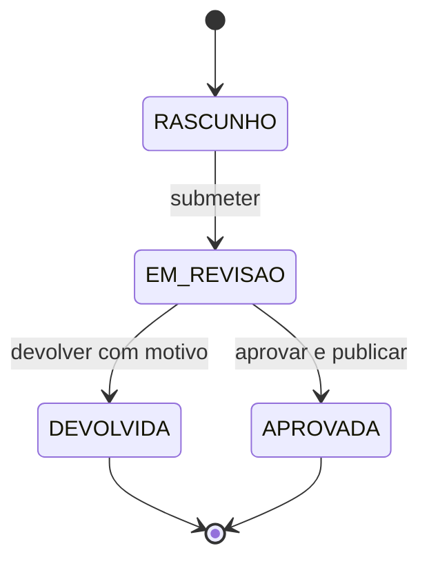

# Arquitetura e modelo relacional

## Base e pressupostos

O NexoPlan trabalha com um contexto de planeamento, séries mensais por produto
e horizontes configuráveis. Um lote representa uma importação versionada de dados.
A gestão de armazéns e a execução de compras ficam fora do âmbito do MVP.

## Estrutura

O **monólito modular** usa Java 17, Spring Boot e MySQL. O Spring Boot serve a
interface em HTML, CSS e módulos JavaScript, além da API REST. O Docker Compose
executa a aplicação e a base de dados. O Maven Wrapper compila e testa o backend,
e o Flyway aplica as migrações SQL.

Os módulos agrupam identidade, catálogo, importações, previsão, cenários,
publicação e monitorização. Os controllers recebem e validam os pedidos. Os
serviços aplicam as regras de negócio e os limites transacionais. A persistência
usa JPA e consultas SQL. Os contratos JSON usam DTOs.

O motor suporta Média Móvel recursiva e ETS(A,A,N) com tendência aditiva. A
execução regista o método efetivo e os diagnósticos por produto. Os detalhes
estão nos guias de [Média Móvel](previsao-media-movel.md) e [ETS](previsao-ets.md).

## Modelo relacional

O SQL executável encontra-se em `backend/src/main/resources/db/migration/V1__schema_inicial.sql`.
A V1 define 21 tabelas, agrupadas por responsabilidade. A V3 acrescenta as tabelas
`backtest` e `backtest_celula` para a comparação de modelos.

| Área | Tabelas | Finalidade |
|---|---|---|
| Acesso e catálogo | `utilizador`, `utilizador_papel`, `produto` | Identidade, vários papéis por conta, código e unidade |
| Entrada | `lote`, `erro_importacao`, `observacao`, `calendario`, `promocao` | Proveniência e dados validados por versão |
| Previsão | `execucao_previsao`, `execucao_produto`, `linha_previsao` | Configuração, método efetivo por produto e baseline |
| Planeamento | `cenario`, `revisao_cenario`, `linha_cenario` | Alternativas isoladas e snapshots de cada revisão |
| Auditoria | `evento_revisao`, `ajuste` | Autor, instante, motivo, célula e valores antes/depois |
| Publicação | `plano_publicado`, `linha_plano` | Revisão aprovada e snapshot consumível |
| Monitorização | `resultado_operacional`, `avaliacao`, `avaliacao_celula` | Dados operacionais, versões dos realizados e população avaliada |

As tabelas de linhas são necessárias: o cabeçalho de uma execução, cenário ou plano
não guarda os valores de cada produto/mês. Os snapshots de publicação fixam código,
unidade, baseline e quantidade aprovada para que exportações históricas não dependam
de futuras alterações ao catálogo.

### Chaves e cadeia de auditoria

`ajuste(revisao_id, produto_id, periodo)` referencia uma célula real em `linha_cenario`.
`ajuste(evento_id, revisao_id)` referencia um evento **da mesma revisão**. O evento
referencia `utilizador` e guarda autor e instante; não é necessário repetir esses
campos em `ajuste`. A justificação e os valores anterior/novo pertencem ao ajuste.
O serviço mantém o motivo do evento coerente com a justificação.

`linha_cenario(revisao_id, execucao_id)` e
`linha_cenario(execucao_id, produto_id, periodo)` garantem que a célula usa uma
previsão da execução que originou a revisão. A revisão de origem só pode pertencer
ao mesmo cenário e execução. Uma nova execução origina novos cenários; não altera
a ligação de cenários existentes.

Não há eliminações em cascata. Produtos e contas usados são desativados.
Lotes validados, observações, previsões concluídas, eventos, ajustes, avaliações e
planos publicados tornam-se imutáveis nos serviços. Correções entram como novos
lotes; `substitui_lote_id` documenta a relação. Cada lote de histórico/realizados é
um snapshot completo do conjunto selecionado para o MVP; não é um delta a combinar
implicitamente com outros lotes. Pode conter vendas e consumo, mas a execução escolhe
uma só série e nunca as soma sem uma regra acordada.

### Tipos e invariantes

- Quantidades `DECIMAL(18,4)` e `BigDecimal` no Java; quatro casas na publicação.
- Mês guardado como `DATE` no primeiro dia; API usa `YYYY-MM` e Java usa `YearMonth`.
- Instantes `DATETIME(6)` convencionados em UTC; configurar sessões JDBC em UTC e
  serializar JSON com `Z`. A interface apresenta a hora local.
- `UNIQUE(lote_id, produto_id, periodo, tipo)` rejeita duplicados no mesmo lote.
- Ausência de observação significa falta de dados; quantidade zero é uma observação
  válida. Não preencher lacunas silenciosamente com zero.
- Índices e FKs compostas referenciam chaves explicitamente únicas, compatíveis com
  as regras de FKs do MySQL 8.4.
- `JSON` guarda parâmetros e pressupostos variáveis. Valores numéricos e relações
  principais permanecem em colunas relacionais.
- No MVP, a unidade de um produto com dados fica fixa; uma nova unidade exige nova
  identidade ou futura regra de conversão. Não somar MAE ou stocks de unidades
  incompatíveis.

### Regras que continuam a pertencer ao backend

As FKs e os CHECKs não garantem sozinhos imutabilidade nem a validade do workflow.
Ainda será necessário implementar e testar:

1. Só lotes `VALIDADO` e do tipo correto podem alimentar uma execução/avaliação.
   Todos os dados usados no treino têm período até ao último mês de treino e
   disponibilidade até ao corte; validar também disponibilidade dos lotes.
2. Uma execução concluída não é recalculada no mesmo ID. As linhas futuras têm de
   corresponder exatamente aos meses e horizonte dessa execução.
3. Uma importação com erro bloqueante não publica linhas parciais. Guardar o lote e
   os diagnósticos, validar o ficheiro completo e inserir os dados/promover o estado
   numa transação. Ficheiros grandes poderão precisar de staging numa fase futura.
4. Só `RASCUNHO` permite ajustes. A justificação usa `strip`/`isBlank` no servidor,
   incluindo tabs e outros espaços, além do CHECK de espaços simples da base.
5. Um evento de ajuste tem tipo `AJUSTE`; um evento de publicação tem tipo
   `APROVACAO`. A FK fixa a revisão, mas a semântica do tipo é validada no serviço.
6. Autoria vem da identidade autenticada, nunca de um `autorId` aceite no pedido.
   ADMIN não recebe permissão de aprovar automaticamente. O aprovador não pode ser
   o criador da revisão nem ter intervindo nos seus ajustes, incluindo os herdados.
7. Ajustes/eventos não têm endpoints de UPDATE/DELETE. A conta SQL de execução terá
   apenas SELECT/INSERT nessas tabelas; migrações usam uma conta separada.
8. O snapshot de publicação copia exatamente as linhas da revisão. Aprovação,
   evento, linhas e cabeçalho do plano persistem na mesma transação.

## Cenários, revisões e concorrência

Uma revisão fixa fator e pressupostos. `quantidade_calculada = round(base × fator, 4)`.
Sem ajustes, `quantidade_final = quantidade_calculada`. Cada ajuste substitui o valor
final; não soma percentagens. Exemplo: base 100, fator 1,10 -> calculada 110;
override para 120 -> evento/ajuste guarda anterior 110 e novo 120. Um segundo
override para 125 guarda anterior 120. A sequência é por célula.

O fator não muda numa revisão com linhas materializadas: pedir outro fator cria
uma nova revisão e recalcula as linhas. Nesta proposta, essa ação não herda overrides;
a interface tem de explicitar que o planeador os revê. Ao corrigir uma revisão
devolvida sem mudar o fator, copiar as linhas finais e ligar a `revisao_origem_id`;
o histórico herdado continua consultável percorrendo essa ligação. Não fabricar
ajustes novos atribuídos a quem apenas copiou a revisão.

A correção de uma devolução cria **outro ID** em `RASCUNHO`; a revisão devolvida
permanece congelada. Aprovação e publicação formam uma única operação no MVP.

Usar `@Version` no campo `versao_lock` e exigir a versão esperada nos pedidos de
mutação. Todos os comandos de uma revisão bloqueiam primeiro a mesma linha de
`revisao_cenario` com bloqueio de escrita. Assim, um ajuste e uma submissão concorrentes
não atravessam a fronteira de congelamento. Ao aprovar, ler/bloquear a revisão,
validar estado e versão e inserir plano, snapshot e evento sob `@Transactional`.
`UNIQUE(plano_publicado.revisao_id)` acrescenta proteção contra publicação repetida.
Um pedido com estado/versão ultrapassado devolve `409 Conflict`; não gera novo evento.
Não existe idempotência genérica por chave nesta primeira versão.

## Monitorização reproduzível

Uma avaliação aponta para um plano, o lote exato de realizados, o lote operacional
quando existe, a janela e a versão do cálculo. `avaliacao_celula` enumera as células
publicadas nessa janela, mesmo sem realizado (`observacao_id = NULL`). A FK composta
impede associar um realizado de outro lote, produto ou mês. O serviço verifica que
a observação tem tipo `PROCURA_REALIZADA` e era conhecida no corte da avaliação.

Para avaliar a previsão publicada, baseline e ajustado usam os mesmos pares elegíveis.
Só se aceitam decisões publicadas antes do início do mês previsto; decisões posteriores
ficam assinaladas e excluídas. Comparações com cenários alternativos podem ser calculadas
por revisão e corte, mas esta primeira persistência de avaliações fica centrada no
plano publicado. Backtests de modelos geram execuções próprias por corte, sem usar
realizados futuros para escolher parâmetros.

- MAE = soma de `abs(previsto - realizado)` / número de pares válidos; inclui zeros.
- MAPE = 100 × média de `abs(previsto - realizado) / abs(realizado)`; exclui realizados
  zero. Sem pares elegíveis, devolver `null`, nunca zero.
- Cobertura: mostrar candidatos, válidos, em falta, excluídos por corte e zeros
  excluídos do MAPE. `ganhoAjuste = maeBase - maeAjustado` nos mesmos pares.
- Serviço = 100 × unidades satisfeitas no prazo / solicitadas. Sem solicitações,
  devolver `null`. Para agregação, somar numeradores e denominadores compatíveis.
- Rutura = 100 × dias com procura e sem stock / dias observados com procura.
  Os contadores mensais têm de ser obtidos a partir de observações diárias na origem;
  stock de fecho mensal não permite inferi-los.
- Excesso = `max(stock_fecho - limite_stock, 0)`; falta de qualquer entrada -> `null`.
- Perdas e prazo médio usam campos operacionais próprios. Não ponderar prazos médios
  de vários períodos sem dados sobre a dimensão de cada amostra.

Calendário e promoções têm datas de disponibilidade para evitar fuga de informação
nos ensaios históricos. Vendas durante indisponibilidade podem subestimar procura;
o painel deve apresentar essa limitação quando os dados operacionais a revelarem.
Resultados operacionais acompanham decisões; não demonstram por si só causalidade.

## Fontes técnicas verificadas

- [MySQL 8.4: foreign keys](https://dev.mysql.com/doc/refman/8.4/en/create-table-foreign-keys.html)
- [MySQL 8.4: CHECK constraints](https://dev.mysql.com/doc/refman/8.4/en/create-table-check-constraints.html)
- [Spring Data JPA: locking](https://docs.spring.io/spring-data/jpa/reference/jpa/locking.html)
- [Spring Framework: transações declarativas](https://docs.spring.io/spring-framework/reference/data-access/transaction/declarative/annotations.html)
