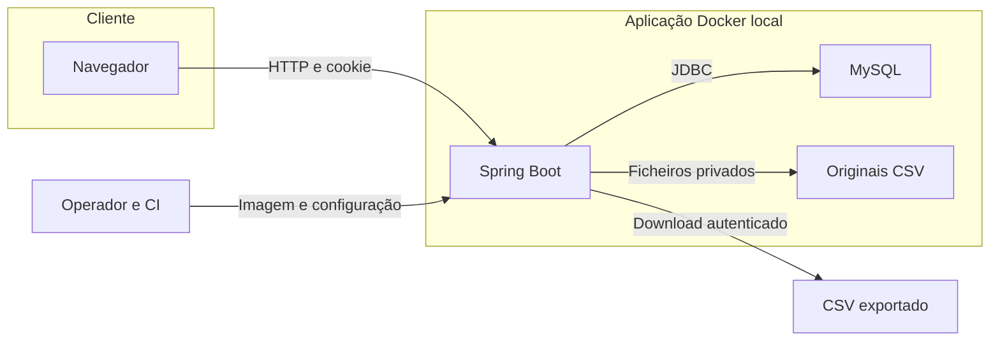

# NexoPlan — modelo de ameaças

Revisão do código local em 18 de novembro de 2026. Contexto confirmado pelo autor: aplicação atualmente usada no próprio computador, dados **sintéticos** que simulam uma empresa e eventual publicação na Internet antes da apresentação final. Não foram consultados registos privados nem executados ataques de carga na instalação de trabalho.

## Executive summary

A superfície principal é uma API Spring Boot com sessões, acessível pela mesma origem da interface. O código contém autorização por perfil, proteção CSRF, rotação e revogação de sessões, validação de ficheiros, consultas parametrizadas e independência de aprovação. Foi identificada e corrigida uma lacuna no controlo de concorrência: criar cenários, copiar revisões, publicar planos e criar contas não partilhavam o limite das restantes operações pesadas. O risco local é sobretudo de indisponibilidade ou alteração indevida da simulação por uma conta comprometida. Uma publicação na Internet exige validar HTTPS, configuração do proxy, gestão de credenciais, proteção de tráfego e backups no alojamento escolhido; estes componentes ainda não foram avaliados.

## Scope and assumptions

- Âmbito: `backend/src/main`, interface em `backend/src/main/resources/static`, migrações, `compose.yaml` e configuração de execução. Os testes são evidência dos comportamentos verificados, não controlos em produção.
- Contexto confirmado: instalação local e dados fictícios; publicação pública futura é possível, mas não existe domínio ou infraestrutura pública definidos nesta revisão.
- Inferência: instalação de uma só empresa, com dados partilhados entre os perfis autorizados. Não existe isolamento entre várias empresas; uma futura versão multiempresa altera este modelo.
- Administradores, operador Docker e utilizador do computador são entidades de confiança. Uma conta ADMIN comprometida compromete a gestão de utilizadores; a separação funcional de aprovação não pretende proteger contra um administrador malicioso que cria outras contas.
- Fora do âmbito: auditoria do sistema operativo, rede pública, configuração de um proxy ainda não escolhido, teste de intrusão independente e análise das camadas das imagens Docker.
- Questões em aberto antes da publicação: alojamento e proxy, quem terá acesso e como serão entregues convites e recuperadas contas. Se forem introduzidos dados reais, reavaliar a confidencialidade e as regras de conservação.

## System model

### Primary components

- **Navegador:** módulos JavaScript e recursos locais; autenticação por cookie e pedidos à API da mesma origem. Evidência: `backend/src/main/resources/static/assets/api.mjs` (`Api.request`, `Api.send`).
- **Servidor Spring Boot:** autenticação, perfis e serviços de importação, previsão, cenários, publicação e monitorização. Evidência: `security/SecurityConfiguration.java` (`securityFilterChain`) e controladores nos respetivos pacotes, todos sob `backend/src/main/java/pt/tiagodias/sop/`.
- **MySQL:** contas, hashes, convites, catálogo, séries e snapshots dos planos. Evidência: `backend/src/main/resources/db/migration/` e `backend/src/main/resources/application.properties`.
- **Volume de importações:** originais CSV com nomes gerados pelo servidor, separados dos recursos web. Evidência: `imports/ImportStorage.java` e `compose.yaml` (`sop_imports`).
- **Construção e CI, separados do runtime:** Maven compila e testa; Docker empacota o JAR e executa com utilizador sem privilégios. Evidência: `backend/pom.xml`, `backend/Dockerfile` e `.github/workflows/`.

### Data flows and trust boundaries

- **Navegador → Spring Boot:** email, password, token CSRF, token de convite, JSON, imagens e CSV por HTTP local. Cookie HttpOnly/SameSite, rotação no login, autorização no servidor e CSP; HTTPS e cookie Secure dependem da futura implantação. Evidência: `security/AuthController.java`, `security/SecurityConfiguration.java`, `application.properties`.
- **Spring Boot → MySQL:** consultas e alterações por JDBC/JPA, com parâmetros, transações, versões e locks. O transporte está configurado sem TLS para a rede local/Docker; não reutilizar esta premissa para uma base remota pública. Evidência: `application.properties` (`spring.datasource.url`), `shared/SearchPage.java`, `planning/PlanService.java`.
- **Upload → parser → MySQL/volume:** ficheiros não confiáveis passam por limites de tamanho, estrutura e conteúdo; fotos são descodificadas e reencodificadas em JPEG, CSV exige UTF-8 e campos válidos. O nome original não determina o caminho de armazenamento. Evidência: `security/PhotoUpload.java`, `imports/HistoricoCsvParser.java`, `imports/OutcomeCsvParser.java`, `imports/ImportStorage.java`.
- **Dados guardados → HTML/CSV exportado:** texto é escapado na interface e células textuais potencialmente interpretadas como fórmulas são protegidas na exportação. Evidência: `static/assets/ui.mjs` (`esc`), `planning/PlanQueries.java` (`safeCsvText`, `export`).
- **Operador/CI → imagem e configuração → runtime:** código, dependências, variáveis e volumes entram por ferramentas de desenvolvimento. Não são entradas que um visitante anónimo possa escrever. Evidência: `backend/Dockerfile`, `compose.yaml` e `.gitignore`.

#### Diagram

## Assets and security objectives

| Asset | Why it matters | Security objective (C/I/A) |
| --- | --- | --- |
| Passwords, sessões e convites | Permitem assumir uma identidade e os seus privilégios | C/I |
| Contas e perfis | Determinam quem pode preparar, aprovar ou administrar | I/A |
| Históricos e pressupostos | Alterações indevidas afetam as previsões e decisões demonstradas | I |
| Ajustes, autoria e planos publicados | A rastreabilidade e os snapshots sustentam o resultado do projeto | I/A |
| Dados sintéticos e fotografias | Confidencialidade reduzida nesta simulação; aumentará se forem substituídos por dados reais | C/I |
| CPU, memória, base e volume | A indisponibilidade interrompe utilização e apresentação | A |
| Código, imagem e configuração | Uma alteração no processo de construção pode comprometer o runtime | C/I/A |

## Attacker model

### Capabilities

No contexto atual, outra aplicação no computador ou um utilizador com acesso ao endereço local pode enviar pedidos HTTP, submeter credenciais e alterar parâmetros. Uma conta autorizada pode enviar ficheiros, repetir operações e tentar rotas de outros perfis. Se o serviço for publicado, visitantes remotos passam a ter essas capacidades anónimas pela Internet. Um atacante com password ou convite válido assume a respetiva conta.

### Non-capabilities

Um visitante não tem, por defeito, acesso ao socket Docker, ao sistema de ficheiros, ao MySQL, ao repositório privado de configuração nem capacidade de escolher SQL, caminhos do servidor ou papéis fora dos endpoints autorizados. Não se assume quebra de BCrypt/SHA-256, execução de código no navegador da vítima ou comprometimento do operador. Estas situações exigem outros modelos.

## Entry points and attack surfaces

| Surface | How reached | Trust boundary | Notes | Evidence (repo path / symbol) |
| --- | --- | --- | --- | --- |
| Login, CSRF e ativação | `/api/v1/auth/*` | Cliente/API | Login e ativação públicos, escritas exigem CSRF; login limitado por endereço/conta, ativação exige convite válido | `security/LoginRequestFilter.java`, `security/AuthController.java`, `identity/ActivationController.java` |
| Gestão e estado de contas | `/api/v1/utilizadores/**` | ADMIN/API/base | ADMIN, versão esperada, auditoria e revogação de convites | `identity/IdentityService.java`, `identity/InvitationService.java` |
| Fotos de conta, equipa e catálogo | Endpoints `/foto` | Cliente/descodificador/base | Leitura autenticada; fotos de equipa só ADMIN; JPEG/PNG normalizados | `security/PhotoUpload.java`, `security/OwnAccountController.java`, `identity/UtilizadorController.java`, `catalog/ProdutoController.java` |
| CSV e lotes | `/api/v1/lotes` | Cliente/parser/volume | 10 MiB, UTF-8, esquema, valores, duplicados e máximo de linhas | `imports/ImportService.java`, `imports/HistoricoCsvParser.java`, `imports/OutcomeCsvParser.java` |
| Previsões, backtests e avaliações | Endpoints dos respetivos módulos | Perfil/API/base | Horizonte, produtos/células e concorrência limitados | `forecasting/ForecastService.java`, `evaluation/BacktestService.java`, `security/RequestLimitsFilter.java` |
| Cenários, ajustes e decisões | `/api/v1/cenarios/**`, `/api/v1/revisoes/**` | Perfil/API/base | Estado, versão, justificação e aprovador independente | `scenarios/ScenarioService.java`, `planning/PlanService.java` |
| Pesquisa e exportação | GET das listas e `/api/v1/planos/{id}/exportacao.csv` | API/cliente/folha de cálculo | Parâmetros ligados, paginação e proteção de fórmulas | `shared/SearchPage.java`, `planning/PlanQueries.java` |
| Recursos públicos e saúde | `/assets/**`, `/api/v1/status`, `/actuator/health` | Cliente/API | Allowlist pública; saúde sem detalhes; restantes rotas recusadas | `security/SecurityConfiguration.java`, `application.properties` |
| Construção/configuração | Maven, Docker e operador | Desenvolvimento/runtime | Fora do acesso HTTP; dependências e segredos continuam a exigir manutenção | `backend/pom.xml`, `backend/Dockerfile`, `compose.yaml`, `.gitignore` |

Os caminhos Java abreviados nesta tabela são relativos a `backend/src/main/java/pt/tiagodias/sop/`.

## Top abuse paths

1. **Assumir uma conta:** obter um email → tentar passwords ou reutilizar uma password conhecida → aceder às operações desse perfil. Os limites de tentativas reduzem força bruta, mas não impedem uma credencial já roubada.
2. **Usar um convite alheio:** obter o link num canal inadequado → definir uma password antes do destinatário → assumir a conta. Hash na base, expiração e uso único não substituem a entrega privada.
3. **Alterar decisões:** obter uma conta de planeador → ajustar quantidades → tentar aprovar com a mesma identidade ou através de uma revisão herdada. A verificação de independência, versão e estado bloqueia este percurso previsto.
4. **Contornar o orçamento de operações:** autenticar-se → enviar criações/cópias de cenários ou publicações paralelas → ocupar threads e base. A revisão corrigiu a ausência dessas rotas no filtro de concorrência.
5. **Consumir armazenamento:** obter perfil de escrita → importar sucessivamente CSV válidos ou rejeitados → acumular originais e registos. Os limites por ficheiro e concorrência não constituem uma quota total de disco.
6. **Injetar conteúdo:** introduzir texto HTML, uma pesquisa com sintaxe SQL ou uma célula textual com fórmula → aguardar apresentação/exportação → tentar executar conteúdo no destino. Escape, parâmetros e proteção CSV reduzem esta superfície; não foi confirmado um bypass.
7. **Intercetar uma futura instalação pública:** publicar HTTP sem TLS → observar credenciais/cookie no trânsito → reutilizar a sessão. Esta ameaça é condicional; o serviço atual está ligado a `127.0.0.1`.
8. **Comprometer configuração ou construção:** obter acesso ao computador, repositório de configuração ou cadeia de dependências → alterar segredos/código/imagem → controlar o serviço. Exige uma fronteira distinta da API HTTP.

## Threat model table

| Threat ID | Threat source | Prerequisites | Threat action | Impact | Impacted assets | Existing controls (evidence) | Gaps | Recommended mitigations | Detection ideas | Likelihood | Impact severity | Priority |
| --- | --- | --- | --- | --- | --- | --- | --- | --- | --- | --- | --- | --- |
| TM-001 | Atacante com acesso HTTP | Conhecer um email ou obter credenciais | Tentar passwords, reutilizar credenciais ou esgotar o limite da conta | Acesso indevido ou bloqueio temporário de login | Contas, dados e disponibilidade | BCrypt12, limite5/conta e60/endereço, erros genéricos (`PasswordConfiguration`, `LoginThrottle`, `AuthController`) | Limites por instância; sem MFA; tentativas dirigidas podem bloquear uma conta15min | Antes de exposição pública, avaliar MFA para privilegiados, política de recuperação e limites no proxy | Registar sucessos/falhas e429 sem passwords/tokens; alertar padrões | low local; medium público | medium nesta simulação | medium |
| TM-002 | Detentor indevido de convite | Obter um token antes da utilização | Ativar a conta alheia | Usurpação da identidade atribuída | Convites e contas | 256bits aleatórios, SHA-256,24h, revogação/consumo transacionais (`InvitationService`); fragmento retirado do URL (`app.mjs`) | Entrega manual fora do controlo da aplicação | Usar canal privado verificado; reduzir prazo conforme operação; nunca guardar links em relatórios ou logs | Auditar emissão, reemissão e ativação sem token | low | medium | low |
| TM-003 | Conta de preparação comprometida | Perfil de escrita autenticado | Manipular quantidades e tentar contornar aprovação/auditoria | Plano indevido | Ajustes, autoria e snapshots | CSRF/RBAC, locks/versão, estado, FK, independência incluindo herdados (`PlanService`, `ScenarioQueries`) | ADMIN é entidade de confiança e pode criar contas; sem auditoria externa imutável | Preservar separação de pessoas; limitar ADMIN; rever eventos e testar independência em regressões | Monitorizar decisões e alterações de contas | low | medium | low |
| TM-004 | Conta autorizada a operações pesadas | Autenticação e pedidos paralelos | Saturar recursos com cópias/publicações/criação de contas | Lentidão/indisponibilidade | CPU, threads e MySQL | **Corrigido nesta revisão:** rotas adicionadas ao limite2global/1porconta, libertação emfinally (`RequestLimitsFilter`, `PlanningOperationLimitsTests`) | O limite não é uma quota por tempo nem partilhado entre réplicas; leituras/exportações ficam fora | Manter testes; aplicar limites de tráfego e métricas no alojamento futuro |429, latência, pool JDBC, CPU e duração das operações | low local após correção; medium público | medium | medium |
| TM-005 | Planeador malicioso ou conta comprometida | Perfil com importação | Enviar muitos ficheiros/linhas ao longo do tempo | Disco ou base esgotados | Volumes e disponibilidade | Tamanho10MiB, linhas100000, duas operações, nomesUUID/0600 (`ImportService`, parsers, `ImportStorage`) | Sem quota acumulada ou política de conservação de originais | Definir orçamento de disco, alertas e conservação compatível com auditoria antes de uso continuado | Espaço livre, crescimento por lote, taxa de rejeições | low local; medium uso público continuado | medium | medium |
| TM-006 | Utilizador com entrada textual/ficheiro | Perfil autorizado ou leitura de exportação manipulada | SQL/HTML/fórmulas através de dados | Alteração de consultas ou conteúdo ativo no cliente | Integridade e sessão | Consultas parametrizadas (`SearchPage`); `esc`/CSP; `safeCsvText`; fotos reencodificadas | Não foi confirmado bypass; comportamento de folhas de cálculo e futuras alterações podem divergir | Conservar testes de regressão e validar novos destinos de exportação; não tratar dados importados como HTML | Erros controlados e casos de teste com entradas hostis | low | medium se surgir bypass | low |
| TM-007 | Observador de rede | **Só se** a aplicação for publicada sem transporte seguro | Intercetar login/cookie ou tráfego da base remota | Sequestro de sessão e acesso aos dados | Credenciais/sessões | Portas atuais apenas em127.0.0.1; HttpOnly/SameSite (`compose.yaml`, `application.properties`) | HTTP local, cookie Secure desativado e JDBC sem TLS são premissas locais | Configurar/testar HTTPS, Secure e HSTS no domínio final; rever proxy confiável e TLS da base se remota | Verificação externa dos redirecionamentos/cookies/certificado | low local; high se HTTP público | high quando público | high |
| TM-008 | Acesso ao anfitrião ou cadeia de construção | Permissões fora da API | Ler configuração/backups ou alterar dependências/imagem | Comprometimento completo da instância | Segredos, código e base | Configuração fora deGit, processo não root/read-only e recursos limitados (`.gitignore`, Dockerfile, Compose) | O estado do anfitrião, backups externos e camadas das imagens não foi auditado aqui | Proteger configuração/backups, substituir credenciais de demonstração antes de publicação e manter inventário/atualizações | Alertas de repositório, análise de dependências/imagens e ensaios de restauro | low no âmbito local | high | medium |

As prioridades não representam vulnerabilidades exploráveis confirmadas em todas as linhas. TM-004 é a lacuna de implementação corrigida; as restantes descrevem percursos de abuso, controlos existentes e riscos residuais/condicionais. A confidencialidade dos dados aumenta materialmente se a simulação passar a conter dados reais.

## Criticality calibration

- **critical:** execução remota anónima no servidor; acesso arbitrário à base sem autenticação. Nenhum foi confirmado nesta revisão.
- **high:** bypass de autenticação/perfis que permita administrar; roubo de sessões por uma implantação pública sem TLS. O segundo depende de uma implantação futura inadequada, não do estado local atual.
- **medium:** uma conta autorizada provocar indisponibilidade relevante; esgotamento acumulado do volume de importações. O carácter sintético dos dados reduz o impacto de confidencialidade, mas não o de disponibilidade.
- **low:** tentativa de injeção bloqueada pelos controlos existentes; comprometimento de um convite que exija primeiro acesso a um canal privado. Os pressupostos e o alcance da conta podem elevar estes exemplos.

## Focus paths for security review

| Path | Why it matters | Related Threat IDs |
| --- | --- | --- |
| `backend/src/main/java/pt/tiagodias/sop/security/SecurityConfiguration.java` | Allowlist de rotas, perfis, CSRF, CSP e sessão | TM-001,003,006,007 |
| `backend/src/main/java/pt/tiagodias/sop/security/AuthController.java` | Autenticação, rotação e identidade usada nos limites | TM-001 |
| `backend/src/main/java/pt/tiagodias/sop/security/CurrentAccountFilter.java` | Revogação por estado/versão e duração absoluta | TM-001,003 |
| `backend/src/main/java/pt/tiagodias/sop/security/RequestLimitsFilter.java` | Cobertura das operações pesadas e orçamento global/por conta | TM-004,005 |
| `backend/src/main/java/pt/tiagodias/sop/identity/InvitationService.java` | Emissão, expiração, revogação e ativação transacional | TM-002 |
| `backend/src/main/java/pt/tiagodias/sop/identity/IdentityService.java` | Criação e desativação de contas com auditoria | TM-001,003 |
| `backend/src/main/java/pt/tiagodias/sop/security/PhotoUpload.java` | Descodificação de bytes não confiáveis | TM-006 |
| `backend/src/main/java/pt/tiagodias/sop/imports/` | Validação e armazenamento de originais | TM-005,006 |
| `backend/src/main/java/pt/tiagodias/sop/planning/PlanService.java` | Independência, transições e snapshot publicado | TM-003,004 |
| `backend/src/main/java/pt/tiagodias/sop/planning/PlanQueries.java` | Exportação autenticada e proteção de fórmulas | TM-006 |
| `backend/src/main/resources/static/assets/` | Escape de dados, convites e gestão da sessão no navegador | TM-002,006 |
| `backend/src/main/resources/application.properties` | Cookies, TLS da base, limites e encaminhamento | TM-004,007 |
| `compose.yaml` e `backend/Dockerfile` | Isolamento, exposição de portas e cadeia de construção | TM-007,008 |

## Notes on use

- [x] Superfícies HTTP descobertas agrupadas e referenciadas.
- [x] Fronteiras navegador/API, API/base, ficheiros, exportação e construção representadas nos percursos de ameaça.
- [x] Runtime separado de ferramentas de desenvolvimento e CI.
- [x] Contexto corrigido pelo autor incorporado: dados sintéticos, uso local, Internet possível no futuro.
- [x] Pressupostos de empresa única e implantação futura explícitos.
- A verificação de execução dos testes e eventuais outras correções são registadas no relatório de testes desta revisão; este documento não substitui os respetivos resultados.
- Este modelo deve ser revisto quando forem escolhidos domínio/proxy/alojamento, introduzidos dados reais, múltiplas empresas ou novas integrações.
